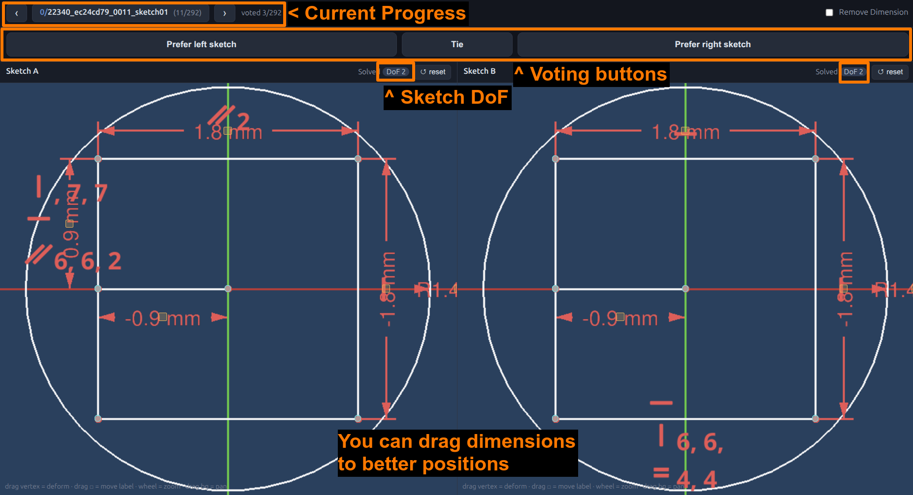
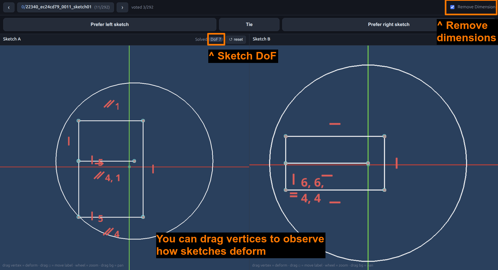

# SketchEval — A/B preference study

Look at two CAD sketches side by side and pick the better one. Runs inside FreeCAD and
opens in your browser. Works on **Windows, macOS, and Linux**.

## 1. Install FreeCAD 1.1.1

Get the official **FreeCAD 1.1.1** for your OS from
<https://www.freecad.org/downloads.php>.

## 2. Launch

We strongly recommend to save and close all existing FreeCAD documents beforehand.

Open FreeCAD → **View → Panels → Python console**, then paste these lines — replacing [you] with your username.

**Windows** (keep the `r"..."`):
```python
import sys
sys.path.insert(0, r"C:\Users\[you]\Downloads\user_study")
import compare; compare.main()
```

**macOS / Linux:**
```python
import sys
sys.path.insert(0, "/home/[you]/Downloads/user_study")   # macOS: /Users/[you]/Downloads/user_study
import compare; compare.main()
```

A browser tab opens automatically (if not, go to <http://127.0.0.1:8000/>).
FreeCAD then **minimizes itself** and you work entirely in the browser — that's
expected; just leave FreeCAD running in the background.

## 3. What to judge

For each pair, click **Prefer left sketch**, **Tie**, or **Prefer right sketch**,
answering this one question:

> **Which constraint set would you use if you had to constrain this sketch yourself and
> could make modifications on top of the generated constraints?**

It auto-advances after each click. (Left/right are randomized and anonymized.)

**Tips**
- The sketch's **DoF** is shown at the top-right of each panel.
- **Remove Dimension** lets you compare only the *relational* constraints.
- **Vertices and dimension labels are draggable** — test how each sketch holds its shape.



